   
  

     
  

  

 
 

### 💡 My Developer Journey
> *"I believe the best software lives at the intersection of **human-centric design** and **strict engineering precision**."*

I bring a unique blend of UI/UX empathy and robust technical discipline to Full-Stack Development. I don't just write code to make things work; I build interfaces that feel natural and a strict testing and compliance mindset:

1. 🎨 **UI/UX & Accessibility:** I don't just build interfaces; I focus on the entire user journey. I am passionate about translating Figma designs into responsive, clean interfaces using React, Tailwind CSS, and Shadcn UI. Coming from an SEO background, I care a lot about writing clean, semantic HTML and ensuring strict web accessibility (WCAG 2.1) are my top priorities.
2. 🤖 **AI-Powered Ecosystems:** I actively integrate modern AI tools into web applications. Using the **Vercel AI SDK** and **Google Gemini**, I build real-time streaming experiences. I also leverage AI-assisted tools like **Cursor** and **Claude Code** to iterate rapidly and learn efficiently.
3. ⚙️ **The QA Mindset (Testing & CI/CD):** Thanks to my QA background, testing isn't an afterthought for me. I try to think about edge cases early and write end-to-end tests using **Jest** and **Playwright**, and automated **CI/CD** pipelines via GitHub Actions to catch bugs before they reach production.

**Core Equation:** `(Empathy + Aesthetics) × Type-Safe Code = Reliable Digital Experiences`

### 🚀 What I'm Up To
- 🔭 **Currently working as:** Full-Stack Development Intern at a Norway-based B2B SaaS startup, building full-stack features with Next.js, Tailwind, and **Firebase** integrations.
- 🌱 **Currently learning:** WebSockets for real-time collaboration (integrating live chat into my AI Copilot project), advanced layout animations for better UX and diving deeper into Next.js App Router patterns.
- 💬 **Ask me about:** Transitioning into tech, Figma-to-code workflows, React state, Vercel AI SDK streaming, and E2E testing with Playwright.

 

📫 **If you would like to reach out or collaborate, feel free to contact me via the channels below!**

 
   
   

 

 
   <!-- Motivasyon Sözü -->

 
  

 
 

  <picture>
    <source media="(prefers-color-scheme: light)" srcset="https://raw.githubusercontent.com/muge-yilmaz/muge-yilmaz/main/dist/pet-light.svg">
    
  </picture>

---
### 🛠 Tech Stack & Most Used Languages

  <!-- Sağ tarafa yaslanmış büyük Diller Grafiği -->
  

  <!-- Frontend & UI/UX İkonları -->
  <b>Frontend & UI/UX</b> 
  <!-- 1. Satır: Sadece ilk 7 ikon -->
  
   
  <!-- 2. Satır: Kalan 6 ikon + Shadcn UI tam yanlarında -->
   &nbsp;
  
     
  
  <!-- Backend, DB & Testing İkonları -->
  <b>Backend, DB & Testing</b> 
  <!-- 1. Satır: İlk 5 ikon -->
  
   
  <!-- 2. Satır: Kalan 5 ikon + Upstash tam yanlarında -->
   &nbsp;
  

 

### 🚀 Featured Projects

#### 🤖 [AI Career Copilot](https://ai-career-copilot-drab.vercel.app/)
- **Description:** An AI-powered career optimization system that generates ATS-tailored resumes, analyzes technical skill gaps, and prepares candidate interview strategies.
- **Key Tech:** Next.js (App Router), TypeScript, Tailwind CSS, Prisma ORM, MongoDB Atlas, Auth0, Vercel AI SDK, Google Gemini, Upstash
- **Links:** [Live Demo](https://ai-career-copilot-drab.vercel.app/) | [GitHub Repository](https://github.com/muge-yilmaz/ai-career-copilot)

---

#### 🛒 [NXT Store | Modern E-commerce Web Application](https://nxt-store-ecommerce.vercel.app)
- **Description:** An end-to-end full-stack e-commerce platform built to handle unified server-side rendering, secure checkout flows, and dynamic database queries.
- **Key Tech:** Next.js, React, TypeScript, Node.js, Prisma ORM, MongoDB, Auth0, Stripe API, Playwright, Jest, GitHub Actions
- **Links:** [Live Demo](https://nxt-store-ecommerce.vercel.app) | [GitHub Repository](https://github.com/muge-yilmaz/NXT-Store-Ecommerce)

---

#### 💡 [Interactive Quote Engine](https://interactive-quote-engine.vercel.app)
- **Description:** A dynamic estimation tool leveraging Next.js for client-server state synchronization, identity management, and REST APIs.
- **Key Tech:** React, Next.js, TypeScript, Tailwind CSS, Auth0, MongoDB Atlas, Node.js, REST APIs, WCAG 2.1
- **Links:** [Live Demo](https://interactive-quote-engine.vercel.app) | [GitHub Repository](https://github.com/muge-yilmaz/Interactive-Quote-Engine)

---

  <picture>
    <source media="(prefers-color-scheme: light)" srcset="https://raw.githubusercontent.com/muge-yilmaz/muge-yilmaz/main/dist/isocat-light.svg">
    
  </picture>

### 📊 GitHub Analytics

  <!-- Ana İstatistikler ve Seri (Streak) -->
    
    

   

  

  

     

  

